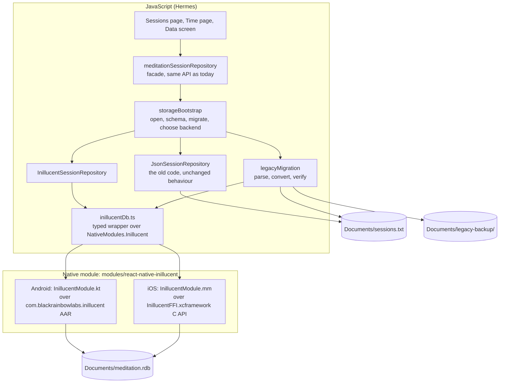
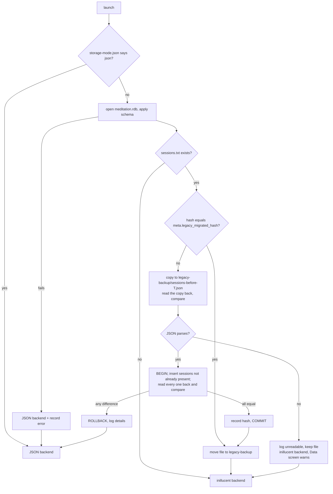

# Meditation app: sessions stored in inillucent (task-2445)

## Introduction

The Meditation app (`C:\jason\dev\meditation-v2`, React Native 0.79, new architecture, Hermes) keeps
every meditation session in one JSON file, `Documents/sessions.txt`. Every save and every delete
rewrites the whole file. task-2434 built inillucent for Android (a Kotlin library over the C
library) and for iOS (an XCFramework of the C library plus a Swift package). This change moves the
app's sessions into an inillucent database, `Documents/meditation.rdb`, and converts the JSON file the
first time the new version runs.

The JSON file on Jason's phone is the only copy of years of sessions. The conversion therefore never
deletes it, checks every converted session against the original before it commits, can be run again
safely after a crash at any point, and gives the person ways out when something goes wrong.

## Goals and non goals

**Goals**

1. Sessions are read and written through inillucent on Android and on iOS.
2. The first launch of the new version converts `sessions.txt` into the database. Every session in
   the file is either in the database, field for field, or recorded in a quarantine table with its
   original JSON text. Nothing is dropped.
3. The original file is kept: a byte checked copy is written to `Documents/legacy-backup/` before the
   conversion starts, and after a successful conversion `sessions.txt` itself is moved into that
   folder, not deleted.
4. When conversion fails, the app keeps working on the JSON file exactly as the old version did, and
   tells the person.
5. A Data screen shows what happened and offers: retry the conversion, re-import a backup file,
   share the original file, export all sessions as JSON, and switch back to the JSON file.
6. Verified on an Android emulator on this machine and on an iOS simulator on a GitHub macOS runner,
   both with a legacy `sessions.txt` seeded before the first launch.
7. The task modal on the Tasks board gets a `Meditation` project in its project dropdown.

**Non goals**

- Encrypting the database. The JSON file is not encrypted today. inillucent supports a key, and the
  bridge accepts one, so it can be turned on later with a Keystore/Keychain key.
- Moving media files. Photos, videos and audio stay where they are; only their file names are rows.
- Publishing the React Native bridge to npm. It lives in the app repository as a local module.
- Changing the screens, other than the new Data screen and its entry point.

## Problem statement

- `sessions.txt` is rewritten in full on every save and delete. A crash or a full disk in the middle
  of `RNFS.writeFile` leaves a truncated file, and `JSON.parse` then fails on every launch, so the
  sessions list never loads again.
- There is no backup, no version marker and no way to recover from a bad file inside the app.
- `userPreferencesRepository` points at the same `sessions.txt` path. It has no callers today, but the
  first caller would overwrite every session with a preferences object.
- Reading is a full parse of the whole history on every cold start.

## Architectural overview



## Components and interfaces

### Native module `Inillucent` (modules/react-native-inillucent)

A legacy bridge module (`NativeModules.Inillucent`). React Native 0.79 runs it through the new
architecture's interop layer, so the app needs no codegen spec. Every method returns a promise and
runs on the module's background queue. Each database id owns one inillucent database and one
connection; calls on one id run one after another.

| Method | Returns | Notes |
|---|---|---|
| `version()` | `string` | engine version, shown on the Data screen |
| `open(path, key?)` | `number` | creates the file when absent |
| `execute(id, sql, params)` | `{columns, rows, changes}` | params are `null`, number, string or boolean; integral numbers bind as integers |
| `executeBatch(id, sql)` | `null` | several statements, for the schema |
| `backupTo(id, path)` | `null` | inillucent copies and opens the copy to check it |
| `integrityCheck(id)` | `null` | rejects with the engine's message when the file is damaged |
| `close(id)` | `null` | |

A failure rejects with `code` set to the engine status name (`SYNTAX`, `CONSTRAINT`, `UNSUPPORTED`,
...) and `message` set to the engine's message.

- **Android** depends on the release AAR from `inillucent/packages/android`, with its native
  libraries stripped (10 MB for three ABIs), checked in as a one artifact Maven repository under
  `modules/react-native-inillucent/android/libs/maven`. A library module cannot depend on a loose
  `.aar` file; the Android Gradle plugin refuses to bundle it. `scripts/update-inillucent-android.mjs` rebuilds it from an inillucent checkout and records
  the inillucent commit in `modules/react-native-inillucent/INILLUCENT_COMMIT`.
- **iOS** links `InillucentFFI.xcframework` (the C library and `inillucent_driver.h`), built on a Mac by
  `scripts/build-inillucent-ios.sh` from the same commit. It binds parameters with
  `inillucent_bind_json` and reads results with `inillucent_rows_json`, so values cross the C boundary
  in the engine's own JSON. The XCFramework is a build product and is not checked in.
- Autolinking finds the module through `react-native.config.js` (`dependencies.react-native-inillucent.root`),
  so `package.json` and `node_modules` do not change.

### Schema (version 1)

```sql
CREATE TABLE meta (key TEXT PRIMARY KEY, value TEXT NOT NULL);
CREATE TABLE session (
  id TEXT PRIMARY KEY,
  seq INTEGER NOT NULL,        -- list order: higher is newer; the JSON array order is kept
  date_ms INTEGER, duration_ms INTEGER, notes TEXT, rating REAL,
  extra_json TEXT              -- any field the columns do not hold, or hold with a different type
);
CREATE INDEX session_seq ON session (seq);
CREATE TABLE session_media (
  session_id TEXT NOT NULL, list TEXT NOT NULL,   -- list is 'media' or 'photos'
  position INTEGER NOT NULL, file_name TEXT NOT NULL,
  media_type TEXT, legacy INTEGER, extra_json TEXT,
  PRIMARY KEY (session_id, list, position)
);
CREATE TABLE legacy_quarantine (id INTEGER PRIMARY KEY, found_at_ms INTEGER NOT NULL,
  source TEXT NOT NULL, reason TEXT NOT NULL, raw_json TEXT NOT NULL);
CREATE TABLE migration_log (id INTEGER PRIMARY KEY, at_ms INTEGER NOT NULL, kind TEXT NOT NULL,
  outcome TEXT NOT NULL, detail TEXT NOT NULL);
```

`meta.schema_version` is `1`. A later schema change adds a numbered step; the bootstrap runs the steps
above the stored version in one transaction.

**Conversion keeps every field.** A known field whose JSON type matches its column goes in the column.
Every other field, and a known field with an unexpected type (say a `dateMs` stored as a string),
goes into `extra_json` and is put back on read. `notes` and `rating` may be absent in sessions from
older versions, so the columns allow NULL and NULL reads back as an absent field. A session whose
`id` is missing, or repeats an earlier session's `id`, gets a new id (`legacy-<n>`), and its original
id, if any, is kept in `extra_json` as `legacyId`. A record that is not a JSON object cannot become a
session and goes to `legacy_quarantine` with its JSON text.

### Conversion (legacyMigration.ts)



- **Idempotent.** Sessions are inserted only when their id is absent, and a present id is compared
  instead of overwritten. A crash between the commit and the move simply runs the conversion again on
  the next launch, finds every session already present and equal, and moves the file.
- **Checked before commit.** The comparison reads each session back through the same code the
  repository uses for the list, inside the open transaction, and compares it with the parsed JSON
  after one normalisation: an absent `media` or `photos` list equals an empty one, which the app
  already treats the same. Any difference rolls the whole conversion back, and that launch runs on the
  JSON file.
- **Report.** Each outcome is a `migration_log` row and is also written to
  `Documents/storage-report.json` (mode, counts, timings, error), which the Data screen reads and the
  device tests check.

### Repository

`meditationSessionRepository` keeps its current methods (`getMeditationSessions`,
`saveMeditationSession`, `deleteMeditationSession`, `deleteAll`) so callers do not change. Each call
waits for the bootstrap, then delegates to the backend it chose. The inillucent backend writes a
session and its media rows in one transaction, deletes media files and then rows, and announces the
new list on `appEventBus` as today.

### Data screen

Opened from a button on the Sessions page header (`testID="data-button"`). It shows the storage in
use, the inillucent version, the session count, the conversion result with its date and counts, and
the quarantine count. Actions:

| Action | What it does |
|---|---|
| Retry conversion | runs the conversion again on `sessions.txt` |
| Re-import a backup | lists `legacy-backup/*.json`, merges the chosen file (ids already present are kept) |
| Share original file | opens the share sheet with the original JSON text |
| Export sessions | opens the share sheet with every session as JSON in the old file format |
| Use the JSON file | backs up the database (`backupTo`), writes every session to `sessions.txt`, writes `storage-mode.json = json`, and reloads |
| Use inillucent | replaces the database's sessions with `sessions.txt` after a database backup, clears the mode file, and reloads |

## Data flows and risks

| Risk | Handling |
|---|---|
| Native library missing or fails to load (bad ABI, old build) | `open` rejects, the bootstrap records the error and uses the JSON backend; nothing has changed on disk |
| Conversion differs from the original | rolled back before commit; JSON backend; details in the log and the Data screen |
| Crash during conversion | the transaction never committed, or it did and the next launch finds every row present; the file is moved only after commit |
| Truncated or unreadable `sessions.txt` | kept in place and copied to `legacy-backup`; the Data screen offers share and retry |
| Disk full during the move | the move fails, the file stays; the hash in `meta` stops a second import |
| The engine refuses a statement as `UNSUPPORTED` | the schema and queries use only tables, a primary key, an index, plain selects and plain transactions, all checked on the engine in jest and on the devices |
| Two launches race | the app is single process; all calls on one database id are serialised on the native side |

## Alternatives considered

| Option | Why not |
|---|---|
| Keep JSON, write to a temp file and rename | fixes truncation, but not reads of the whole history, and the ticket asks for inillucent |
| A React Native binding inside the inillucent repository (`packages/react-native`) | the right long term home, but it needs npm publishing and its own CI and guards; the module here has the same interface and can move there unchanged |
| Call the Swift package from a Swift module on iOS | needs the Swift sources and a module map inside a CocoaPod; the C API with `bind_json` and `rows_json` is a smaller surface and needs only the header |
| Build the AAR during the app's Gradle build (`includeBuild`) | every app build would need Rust and three cross toolchains |
| Delete `sessions.txt` after conversion | removes the only way back; keeping a few hundred KB is cheap |

## Testing strategy

1. **jest against the real engine.** The `inillucent` npm package's C library loads into Node as an
   addon. A test double of `NativeModules.Inillucent` drives it, so the repository, schema and
   conversion tests run real SQL: conversion of a realistic history (emoji, NUL free text, legacy
   photos, media, missing fields, odd types, duplicate and missing ids, non object records); a second
   run changes nothing; a crash between commit and move; an unreadable file; a forced comparison
   failure rolls back and selects JSON; save and delete round trip; export then re-import gives the
   same sessions; switching to JSON and back loses nothing.
2. **Android emulator (this machine).** `scripts/device-test-android.mjs` builds the debug app, installs
   it, writes a legacy `sessions.txt` (40 sessions, emoji, photos, media) into the app's files through
   `adb run-as`, launches, waits for `storage-report.json`, and checks: mode `inillucent`, 40
   converted, 0 quarantined, `sessions.txt` moved into `legacy-backup`. Then the Maestro flows check
   the converted notes are on the Sessions page and that a new session saves and survives a restart.
3. **iOS simulator (GitHub Actions, macos-latest).** `.github/workflows/ios.yml` builds the
   XCFramework from the pinned inillucent commit, installs pods, builds the app for the simulator in
   Release, seeds the same `sessions.txt` into the app container with `xcrun simctl`, launches, and
   runs the same report checks and Maestro flows.

## What implementation found

| Finding | What changed |
|---|---|
| A fresh `npm ci` could not build Android: react-native-track-player 4.1.1's `MusicService.onBind` does not compile against the current Android SDK. The main checkout had the fix typed into `node_modules` by hand. | `patches/react-native-track-player+4.1.1.patch`, applied by the existing `postinstall` |
| A session with no `rating` (written before ratings existed) crashed the Sessions page in StarRating. The JSON version crashes on the same data. | `MeditationSession.tsx` shows 0 stars for a missing rating |
| A debug build looks for Metro on the host's port 8081, which is a different service on the development machine, and a Maestro `clearState` wipes the setting that points it elsewhere. | `scripts/bundle-js-in-debug.gradle`: a Gradle init script that bundles the JavaScript into a debuggable build, so the device tests need no Metro |
| `inillucent/packages/swift/build-xcframework.sh` always built the two macOS slices. | inillucent 3aa2aa10: `INILLUCENT_APPLE_PLATFORMS="ios simulator"` builds only what an iPhone app links |
| The conversion is shown as an empty Sessions page while it runs. | The Sessions page says "Loading your sessions…" until the first load finishes |

Measured on the Android emulator (x86_64, software GPU), with the JavaScript bundled: 40 sessions
convert in 2.4 s and 400 in 3.2 s, so most of it is a fixed cost and each session adds about 2 ms.
Reading 400 sessions for the list takes 55 ms.
